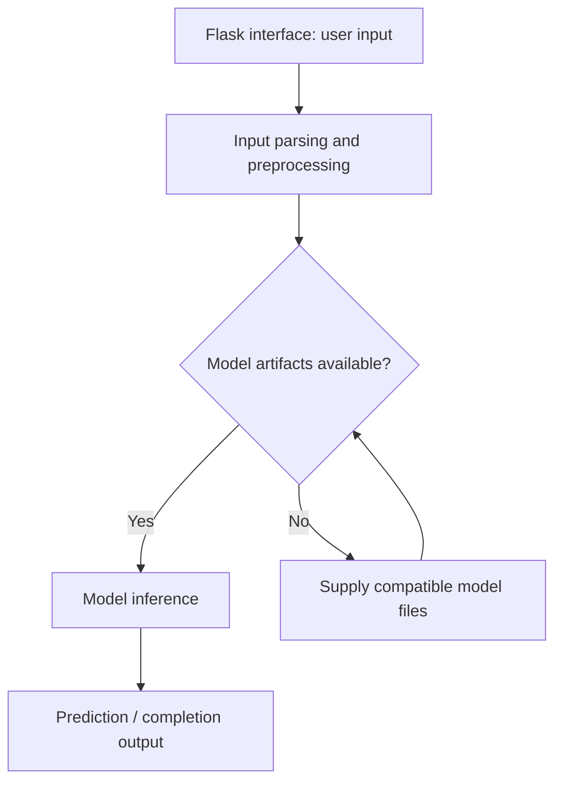

# Bird Species Classification — Flask Demo

Flask image-classification demo that loads a Keras model and predicts among six bird species.

## Project focus

Flask application. The sections below separate the runnable entry point, source layout, prerequisites, and verification path.

## Architecture



## Repository structure

| Path | Purpose |
| --- | --- |
| [`Procfile`](Procfile) | Process-launch configuration. |
| [`app.py`](app.py) | Application entry point or route definitions. |
| [`app/`](app) | Application source; inspect this directory for the framework-specific implementation. |
| [`config.py`](config.py) | Python application helper or learning example. |
| [`requirements.txt`](requirements.txt) | Python dependency manifest. |
| [`sample_data/`](sample_data) | Project-specific source, resources, or learning material. |

## Getting started

```bash
git clone https://github.com/Raimal-Raja/Birds-Species-Prediction-App-using-Flask.git
cd Birds-Species-Prediction-App-using-Flask
```

```bash
python -m venv .venv
source .venv/bin/activate
```

On Windows PowerShell, activate the environment with `.venv\Scripts\Activate.ps1` instead.

```bash
python -m pip install -r requirements.txt
```

```bash
python app.py
```

## Configuration and scope

The checked-in requirements describe a legacy Keras/NumPy stack. They are retained to avoid silently breaking saved-model compatibility; they are not a claim of compatibility with current Python. Reproducing the model requires a matching legacy environment or a separately tested migration. Inspect `app/views.py` for its expected model path.

## Verification

Use the setup commands and inspect the selected interface, example, or notebook with known inputs. This documentation review checks repository paths and dependency declarations; it does not claim fresh end-to-end execution or model-quality measurements.

## Contributing

Include reproduction steps, the affected path, expected behavior, and the checks you ran. Keep credentials, generated environments, and unnecessary build artifacts out of commits.

## License

No top-level license file is currently tracked. Check reuse permissions with the repository owner.
